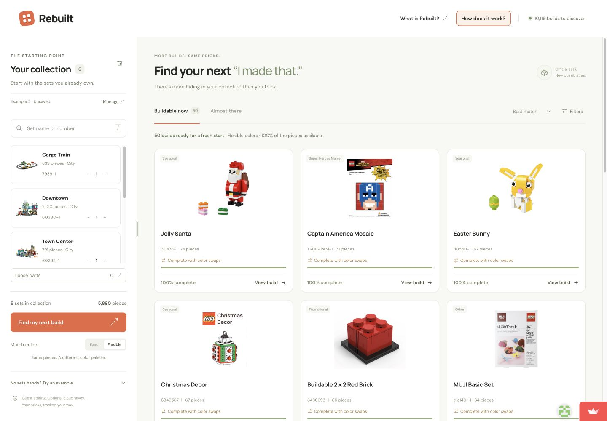
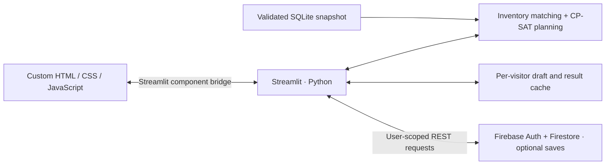

# Rebuilt

**More builds. Same bricks.**

Rebuilt finds official LEGO sets you can make from the pieces you already own, then plans which sets to dismantle to build one. It combines quantity-aware inventory matching, constraint optimization, and optional cloud saves in a custom interface hosted on Streamlit.

[**Open the live app →**](https://brick-finder.streamlit.app/) · [Architecture](docs/architecture.md) · [Development guide](docs/development.md)

[](https://github.com/drat-git/brick-finder/actions/workflows/tests.yml)



*The built-in example collections work without an account. The screenshot shows flexible-color matching; exact colors are the default.*

## Try it in a minute

1. Open the [live demo](https://brick-finder.streamlit.app/), expand **No sets handy? Try an example**, and choose **Example 1**.
2. Select **Find my next build** to find a complete build in its original colors. Switch to **Flexible** to explore more possibilities using the same parts in different colors.
3. Open **View build** to inspect the pieces, then **Plan this build** to see which physical copies supply them.

The app's **How does it work?** page explains the system, product decisions, and optimization model. Creating an account is only needed to save and reload a collection.

## What it does

- **Models physical inventory:** duplicate set copies, missing pieces, loose stock, and copies marked to keep assembled.
- **Finds complete and near-complete builds:** exact part-and-color matching or flexible-color matching, with explicit shortages and substitutions.
- **Plans the dismantling:** OR-Tools CP-SAT minimizes the number of copies opened, then color substitutions. Picking lists identify the source of every piece.
- **Saves collections safely:** Firebase accounts, owner-scoped snapshots, atomic name reservations, and revision checks prevent stale saves from overwriting newer work.

The bundled snapshot contains **19,702 selectable inventories** and **10,116 recommendation candidates**. Discovery works without a live catalog API or Firebase configuration.

## Engineering decisions

| Decision | Reason and trade-off |
| --- | --- |
| Validate CSVs into a bundled, read-only SQLite catalog | Repeatable searches and no runtime catalog API dependency; new sets require an explicit data refresh. |
| Track each physical copy separately | Two copies can have different missing pieces or protection settings; a simple set quantity cannot represent that. |
| Match first, optimize one selected build on demand | Keeps discovery responsive while giving the solver a bounded, focused problem. |
| Default to exact colors and only claim proven minimums | “Ready to build” and “minimum” have precise meanings. Complete timeout results are labeled **minimum not proven**. |
| Use user-token Firebase REST calls | Firestore Rules enforce ownership without an Admin SDK credential. Private drafts and tokens stay in each visitor's server session. |



The [architecture guide](docs/architecture.md) covers inventory accounting, the solver objective, request handling, persistence, and failure behavior. The [catalog guide](docs/catalog.md) documents coverage and import validation.

## Evidence and validation

[GitHub Actions](https://github.com/drat-git/brick-finder/actions/workflows/tests.yml) runs the Python suite, JavaScript transport tests, and Firebase Auth/Firestore emulator checks. Tests cover quantity accounting, color allocation, duplicate copies, dirty drafts, stale revisions, and cross-account isolation.

The planner is checked against exhaustive search on **40 generated cases in both color modes**. A deliberately difficult fixture demonstrates why greedy selection can open **3 copies** when the optimum requires **2**. The recorded benchmark proves optimality on **15 real catalog targets** in approximately **1–32 ms** locally; greedy and optimized copy counts are equal on that small real-data sample.

These are local measurements on Python 3.13.16 / Apple Silicon, not hosted latency guarantees. Inspect the [planner tests](tests/test_planner.py), [matching measurements](data/demo_results.json), and [planner measurements](data/planner_results.json), or reproduce them with the [development guide](docs/development.md#benchmarks).

## Run locally

Requires **Python 3.13**. The catalog is included; guest mode needs no credentials or data download.

```bash
git clone https://github.com/drat-git/brick-finder.git
cd brick-finder
python3.13 -m venv .venv
source .venv/bin/activate
python -m pip install -r requirements.txt
python -m streamlit run app.py
```

On Windows, activate the environment with `.venv\Scripts\Activate.ps1`. Open the URL printed by Streamlit. Optional Firebase configuration, emulator setup, tests, and deployment are documented in the [development guide](docs/development.md).

## Project map

| Path | Responsibility |
| --- | --- |
| [`frontend/`](frontend/) | Custom interface, inventory editing, and correlated Streamlit transport |
| [`app.py`](app.py) | Streamlit entry point and session wiring |
| [`brickfinder/inventory.py`](brickfinder/inventory.py), [`matching.py`](brickfinder/matching.py) | Physical-copy accounting and quantity-aware recommendations |
| [`brickfinder/planner.py`](brickfinder/planner.py) | Greedy fallback, CP-SAT model, and allocation validation |
| [`brickfinder/session.py`](brickfinder/session.py), [`firebase_store.py`](brickfinder/firebase_store.py) | Draft lifecycle, authentication, atomic saves, and conflict handling |
| [`brickfinder/build_catalog.py`](brickfinder/build_catalog.py), [`data/`](data/) | Validated import pipeline, bundled snapshot, and benchmark evidence |
| [`tests/`](tests/) | Unit, integration, transport, optimizer, and Firebase security-rule checks |

## Scope and limitations

Recommendations compare parts lists; they do not simulate assembly geometry. Different prints and molds remain distinct. Each recommendation uses the same collection independently, so several suggested builds may compete for pieces. Plans are advisory and never consume or reserve stock.

The snapshot's recommendation range is **2000–2026, 20–1,000 pieces**. Guest drafts last for the active session; refreshing starts a fresh draft and clears sign-in. Saved collections can be loaded after signing in again. Images and instruction links need internet access. Password recovery, simultaneous-build planning, pricing, and generated instructions are outside the current scope.

## Author and attribution

Built by [Darsh Rathi](https://github.com/drat-git).

Inventory data and set-image links come from [Rebrickable](https://rebrickable.com/downloads/). Instructions link to [LEGO's official service](https://www.lego.com/en-us/service/building-instructions). See [data attribution and permissions](DATA_SOURCE.md).

Independent portfolio project. Not affiliated with the LEGO Group or Rebrickable. LEGO is a trademark of the LEGO Group.
